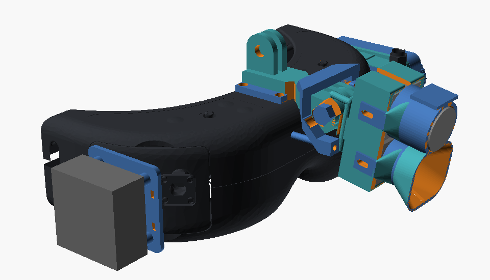

# arabskie_gogle

**Head-mounted thermal vision for walking outdoors at night.** A thermal camera sits on FPV goggles clipped to a
helmet, the picture goes straight into the goggles, and the camera is controlled with a knob and one button on the
side of the goggles.



*Rendered from `cad/scene_all.scad` with `-D hdo_model=true`. The goggle body is the community GrabCAD model
"Fatshark HDO goggles" by Aisak — the original HDO, not the HDO2, and not a manufacturer model. The model file is
not in this repo; without it the scene falls back to a plain stand-in body.*

> **Working draft — nothing has been on hardware yet.** No part has been printed, the firmware has not been compiled
> for the ESP32, and the camera has not arrived. Dimensions come from shop drawings, photos and community models; the
> camera protocol comes from the manual of a sister model. Every number in this repo is a sourced value, a
> calculation or an assumption — not a measurement.

Most of the documentation below this file is in Polish; the research notes are in English.

## How it is meant to work

```
 thermal camera 256×192 ─┐
                         ├─ AI box ── CVBS PAL ──► HDO2 AV input ──► eyes
 night camera "Infra" ───┘     ▲
                               │ GPIO (camera select) + UART (palette, brightness, contrast, NUC)
                    controller pod: XIAO ESP32-C3 + knob + CAM button + vibration motor
                               ▲
                    4S Li-ion pack ──► goggles, camera, controller
```

| Item | What it is |
|---|---|
| Goggles | Fat Shark Dominator HDO2 (assumed since 2026-11-03) |
| Camera | Caddx TR1-220SL Dual: thermal 256×192 (50° × 37.2°) + night camera "Infra" (120°), shared AI box |
| Helmet | Protec, GoPro base on VHB tape |
| Mount | one printed part in place of the goggle fan: holds the cameras at the front and joins the goggles to the helmet at the top |
| Controller | Seeed XIAO ESP32-C3 in a pod in the left VRx module bay; electronics not bought yet |
| Power | 4S Li-ion pack, the one the author already runs the goggles from (decided 2026-11-12; this is above the 13 V in the HDO2 manual — see `ZALOZENIA.md` §1b) |

Controls in short: **short CAM press** switches thermal ↔ Infra, **long CAM press** always returns to thermal,
**turning the knob** changes the parameter of the current mode, **pressing the knob** cycles the mode (brightness →
palette → contrast). Every action is confirmed by vibration, because the controller has no visible display. Full
table: [`firmware/README.md`](firmware/README.md).

## Status (2026-11-12)

| Part | Version | State |
|---|---|---|
| Camera mount and goggle-to-helmet link — `cad/camera_mount.scad` | v0.6 | model + STL, clash tests pass; not printed |
| Controller pod — `cad/pod.scad` | v0.2.1 | model + STL, clash test passes; bay dimensions are placeholders |
| AI box bracket — `cad/aibox_mount.scad` | v0.1 | proposal, awaiting acceptance |
| Controller firmware — `firmware/` | v0.1 | host logic tests 60/60; not compiled for ESP32 |
| Research — `research/01`–`09` | — | working drafts, source quotes in `papers/extracts_*.md` |
| Tactical version — `cad/tactical_mount.scad` | v0.5 | **rejected 2026-11-06, do not print** |

**Before printing anything**, do check U1: unclip the goggle faceplate and see whether the fan cover stays on the
shell. The whole adapter assumes it does (`research/09_hdo2_net_open_items.md`). This and the other open items are
in [`ZALOZENIA.md`](ZALOZENIA.md) §3.

## Running the checks

Needed: `g++`, `python3`, OpenSCAD (the scripts use `openscad-nightly` if present, otherwise `openscad`), `admesh`.

```sh
make -C firmware/test/host            # firmware logic: "OK: 60/60 sprawdzeń"
./cad/test/run_pod_clash.sh           # pod clash test, 40 jobs, about 5 s
./cad/test/run_clash.sh               # camera mount clash test, 80 jobs, about 7 min
./cad/test/export.sh                  # export v0.6 STLs + mesh and overhang checks
python3 cad/web/build_viewer.py       # rebuild the 3D preview
cd cad/web && python3 -m http.server 8765   # preview: http://127.0.0.1:8765/
```

Timings are from the author's machine, OpenSCAD nightly 2026.11.06 (Manifold backend), 2026-11-11. None of these
checks is a test on hardware.

<details>
<summary>What these checks do not cover</summary>

- The firmware tests do not cover `firmware/src/main.cpp` (pins, UART, storage). `pio run` has not been run.
- `run_clash.sh` also checks the GrabCAD model of the original HDO (not the HDO2) if the file is present locally in
  `papers/`; without it that part is skipped and the last output line says so.
- `export.sh` prints 40 informational items for the adapter, cage and coupon (overhangs, an 18.5 mm bridge, flat
  cantilevers); whether they print without supports has not been checked. Print times and masses need a slicer
  profile, which is not in the repo.
- `cad/test/export_tactical.sh` (rejected v0.5) ends with "NIEZALICZONE" (failed) — see `cad/README.md`.
- The browser 3D preview shows only the v0.6 camera mount on the stand-in goggle body, without the pod and AI box.

What each test checks exactly: [`cad/README.md`](cad/README.md), [`firmware/README.md`](firmware/README.md).
</details>

## What is where

| Path | Contents |
|---|---|
| [`ZALOZENIA.md`](ZALOZENIA.md) | design assumptions: hardware, goal, research conclusions, open items, decision table (Polish) |
| `research/` | notes `01`–`09`: camera placement, field of view, camera interface, goggles and helmet, controller and power, HDO2 front and GoPro joint, pod, GrabCAD model, open HDO2 dimensions (English, except `08`) |
| `papers/` | quotes from sources (`extracts_*.md`) and the index [`papers/README.md`](papers/README.md). The sources themselves are kept only locally (`.gitignore`): the repo is public and does not redistribute other people's texts |
| `cad/` | OpenSCAD models, STLs (`cad/stl/`), tests (`cad/test/`), 3D preview (`cad/web/`), v0.5 archive (`cad/spec/`) — described in [`cad/README.md`](cad/README.md) (Polish) |
| `firmware/` | controller (PlatformIO; logic in `lib/core`, tests in `test/host`) — described in [`firmware/README.md`](firmware/README.md) (Polish) |
| `docs/` | the image for this file |
| `photos/` | for photos and measurements of the hardware; empty so far |

## Which document governs

This file is a summary; where it disagrees with the documents below, they govern.

- **Facts and numbers:** the notes in `research/`, and behind them the extracts (`papers/extracts_*.md`) and the
  sources in `papers/`.
- **Decisions:** `ZALOZENIA.md` §4.
- **Part geometry:** the `.scad` files (not `cad/README.md` and not the STLs).
- **Controller behaviour and pins:** the code (`firmware/include/config.h`, `firmware/lib/core/src/ui.h`).
- A later measurement on hardware governs over all of the above.

## License

[MIT](LICENSE). The three.js libraries bundled with the preview carry their own MIT license:
[`cad/web/lib/LICENSE.three`](cad/web/lib/LICENSE.three), described in
[`cad/web/lib/README.md`](cad/web/lib/README.md).
